# Prometheus 基础学习
> Prometheus 是一个开源的时间序列监控系统，专为云原生环境设计。它通过定期抓取（scrape）服务端点的指标数据，存储时间序列数据，并支持 PromQL 查询语言进行灵活的数据分析和可视化。

- **监控与发展史**：
  - 什么是监控：
    > 监控是一种用于实时或定期收集、分析和报告计算机系统、网络或应用程序状态的工具或平台，旨在确保其性能、可用性和安全性。主要功能包括：
    - 性能监控：
        - 跟踪CPU、内存、磁盘、网络等资源使用情况
    - 可用性监控：
        - 检测服务或设备是否正常运行（如网站、服务器）
    - 告警：
        - 当出现异常（如宕机、性能瓶颈）时通过邮件、电话等通知工程师
    - 数据可视化：
        - 通过图表、仪表盘展示系统状态和趋势
    - 安全监控：
        - 检测异常流量或入侵行为
  
    
  
  -  发展史
   
        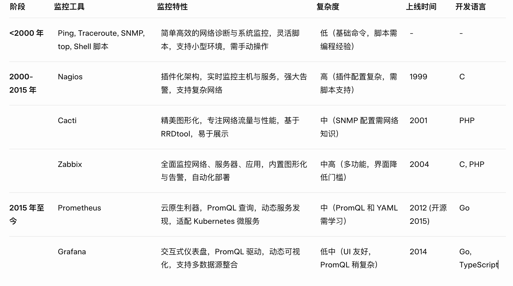
        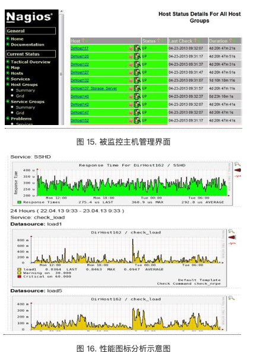

- **Prometheus核心概念**：
  - 时间序列数据（Time Series Data）
    - Prometheus 的数据模型基于时间序列，即按时间戳排序的指标值序列，
       - 格式： metric_name{label="value"} timestamp value
    - http_requests_total{path="/api", status="200"} 1750166703 42
       - 表示某时间点 /api 路径的 200 状态请求总数为 42
  
      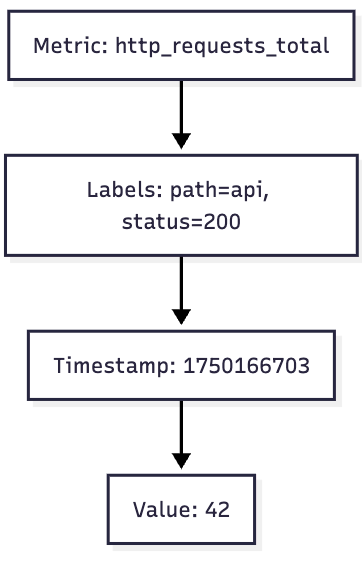

  - 指标类型（Metric Types）
    - Counter（计数器）：
      - 特点：单调递增，永不减少，适合累积数据（如请求总数、错误计数）
      - 图像表现：一条持续上升的折线图，表示数值随时间累积。
      - 示例： CKB 网络钱包地址数量
       
      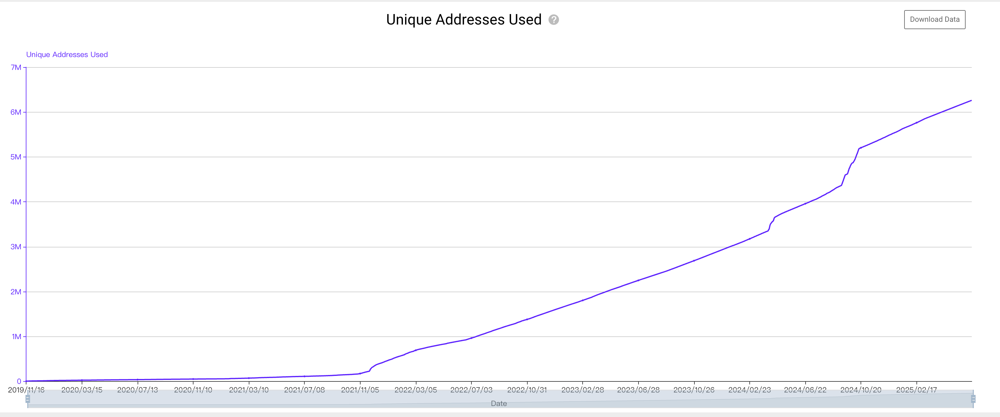

    - Gauge（仪表盘）：
      - 特点：可增可减，反映瞬时值，适合波动数据（如 CPU 使用率、内存占用）
      - 图像表现：波动起伏的折线图，表示值随时间上下变化。
      - 示例：CKB 网络算力
  
      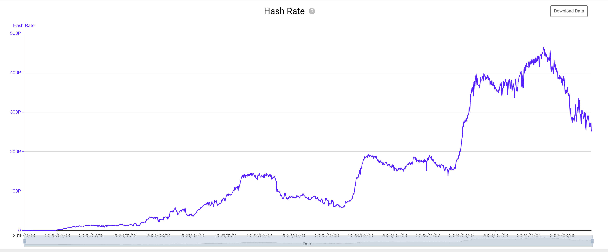

    - Histogram（直方图）：
      - 特点：统计数据分布，记录数值分桶（如请求延迟的分布），提供计数和总和。
      - 图像表现：柱状图（bar chart），展示不同区间的频率分布。
      - 示例：CKB 钱包余额分布
  
      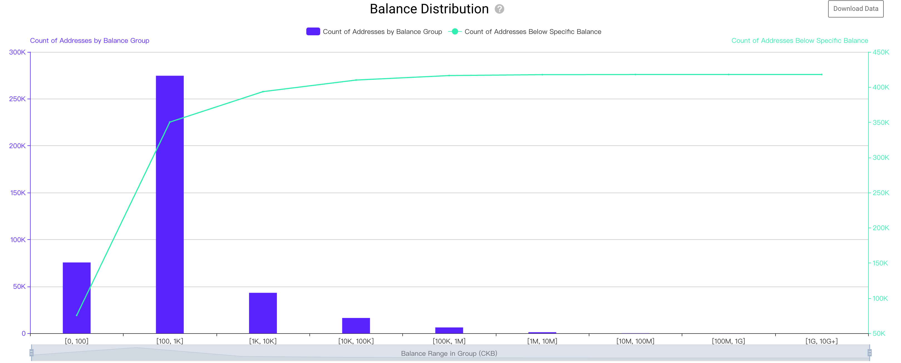

    - Summary（摘要）：
        - 特点：客户端计算的分位数（如 50%、99% 延迟），类似 Histogram 但更轻量
        - 图像表现：折线图或点图，展示分位数值（如 99% 延迟随时间变化）
        - 示例：request_latency_quantiles（请求延迟分位数）
            - 表示HTTP请求的99%分位延迟为0.25秒，总延迟123.45秒，请求次数1000次。
            
            http_request_duration_seconds{quantile="0.50"} 0.1
            http_request_duration_seconds{quantile="0.99"} 0.25
            http_request_duration_seconds_sum 123.45
            http_request_duration_seconds_count 1000

         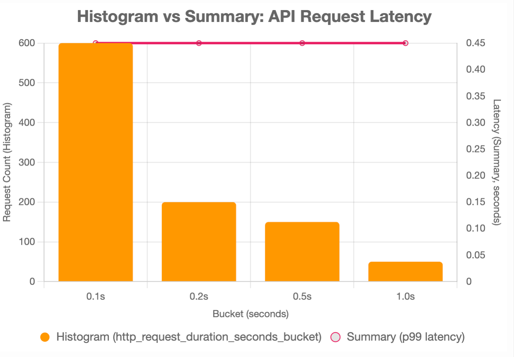
        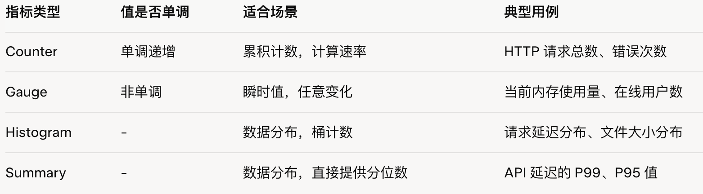

  - PromQL（Prometheus Query Language）
      - PromQL 是一种函数式查询语言，允许用户对时间序列数据执行即时查询、范围查询、聚合操作、数学计算和告警逻辑。
      - 即时查询：检查服务状态
          - 查询:  up
          - 说明：返回所有目标的运行状态（1 表示运行，0 表示宕机）
      - 范围查询 + 速率计算：计算请求速率
          - 查询：rate(http_requests_total[5m])
          - 说明：计算过去 5 分钟内 http_requests_total（Counter 类型）的每秒增长率
      - 聚合操作：按标签汇总
          - 查询：sum by (job) (rate(http_requests_total[5m]))
          - 说明：按 job 标签聚合 http_requests_total 的速率，计算每个作业的总请求速率。
      - 函数应用：检测 CPU 使用率
          - 查询：avg by (instance) (rate(node_cpu_seconds_total{mode="user"}[5m])) * 100
          - 说明：计算每台主机（instance）过去 5 分钟的用户态 CPU 使用率（百分比）
- **Prometheus架构与组件**：
  
    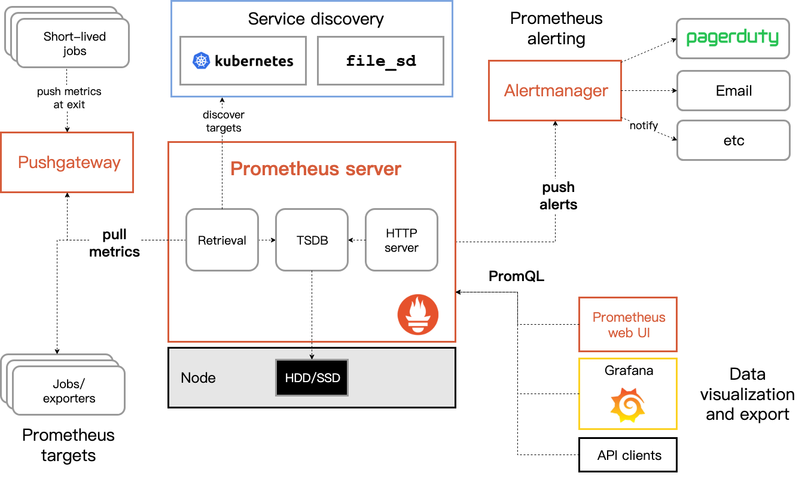

  - Prometheus Server：
    - 负责从目标端点（如 Exporters 或 Pushgateway）拉取（scrape）指标，存储为时间序列数据，提供 PromQL 查询接口，并根据规则触发告警。
    - 数据采集
        - 通过 HTTP 定期从目标的 /metrics 端点拉取指标（如 Node Exporter 的 CPU 使用率）。
    - 数据存储
        - 将指标存储为时间序列数据（格式：metric_name{label="value"} timestamp value）。
    - 查询（PromQL）
        - 提供 PromQL（Prometheus Query Language）查询语言，分析和聚合指标。
    - 告警触发
        - 根据定义的规则（如 up == 0），检测异常并发送告警到 Alertmanager。
    - 服务发现
        - 动态发现监控目标，如通过 DNS 或 Kubernetes API 自动识别 Pod。
  - Exporters：
      - Exporters 负责从目标系统（如数据库、Web 服务器、操作系统等）收集指标，转换为 Prometheus 格式（时间序列数据），并通过 HTTP 端点提供给 Prometheus。
      - 核心作用
          - 指标转换：
              - 将目标系统的状态或性能数据（如 CPU 使用率、数据库查询延迟）转换为 Prometheus 的指标格式（如 name{label="value"} value）。
          - 暴露端点：
              - 通过 HTTP 接口 (如 http://exporter:port/metrics) 提供指标，供 Prometheus 定期拉取。
          - 扩展监控范围：
              - 支持广泛的系统和服务，如硬件、数据库、消息队列、Web 服务器等。
      - 常见 Exporters
          - 系统监控:
              - Node Exporter（硬件/OS指标）、Windows Exporter。
          - 数据库:
              - MySQL Exporter、PostgreSQL Exporter、MongoDB Exporter。
          - Web/网络:
              - Nginx Exporter、Haproxy Exporter、Blackbox Exporter（HTTP探针）。
          - 消息队列:
              - Kafka Exporter、RabbitMQ Exporter。
          - 自定义编写监控 Exporter 
  
    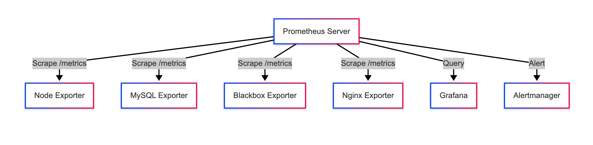

  - Pushgateway：
    - Pushgateway 是允许客户端主动推送（push）指标到中间服务，供 Prometheus 拉取（pull），主要用于短期任务或不适合 Prometheus 拉取模型的场景。
    - 核心作用
        - 允许客户端推送指标
        - 临时存储指标
        - 支持非标准监控场景
    - 使用场景
        - 短期运行的批处理任务（Batch Jobs）
        - 无法部署 Exporter 的环境
        - 跨网络隔离的场景
  
    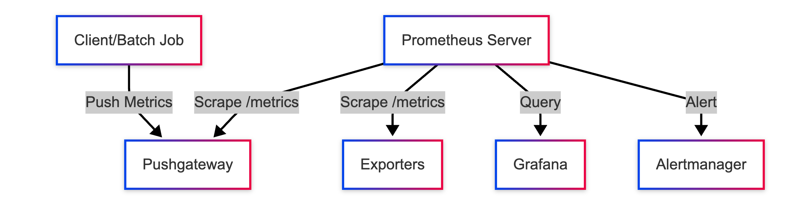

  - Alertmanager：
      - Alertmanager 负责接收、处理和转发 Prometheus 的告警通知，确保告警信息高效、准确地送达用户。

      - 告警处理
          - 分组：将相关告警聚合统一通知，避免通知风暴（如将多个主机宕机告警合并）。
          - 抑制：当某告警被更高级别告警覆盖时，暂停低级别告警（如服务宕机时忽略高延迟告警）。
          - 去重：消除重复告警，确保通知简洁。
      - 通知路由
          - 功能：
              - 根据配置的路由规则，将告警发送到指定的通知渠道。
          - 多级路由：
              - 支持按团队、告警严重性、时间等条件灵活分发告警。
          - 分级告警：可根据优先级配置不同渠道，例如：
              - 高优先级告警（如生产环境故障）发送到 Discord 和 Telegram。
              - 低优先级告警发送到 Email。
  
    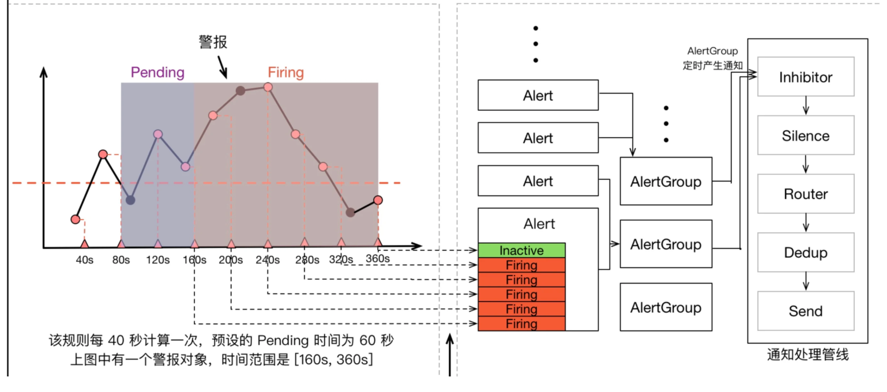

    - 通知集成
        - 支持多种通知方式：
            - Slack、钉钉、Webhook、Email、PagerDuty、Telegram、OpsGenie
        - 自定义通知内容和格式
    
    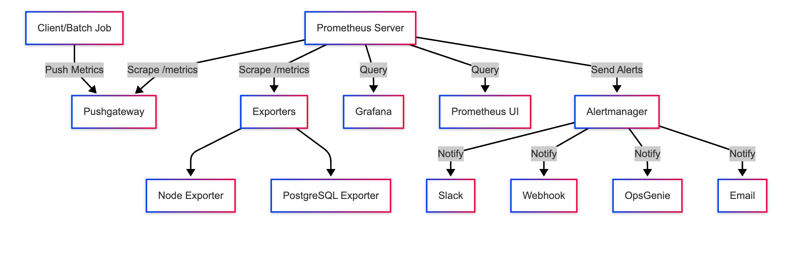
  
- **可视化：**
  > 可视化是 Prometheus 监控系统的关键环节，通过将 PromQL 查询结果以图表、仪表盘等形式展示，帮助用户直观理解系统性能、应用状态和潜在问题。
  - Prometheus Web UI
    - Prometheus 监控系统的内置 Web 界面，集成了数据查询、可视化、状态监控和告警管理功能，图表功能比较弱，适合快速调试、验证指标数据。
  - Grafana：
    - Grafana 是数据可视化平台，也是Prometheus 最常用的可视化前端，通过 PromQL 查询 Prometheus 数据，生成折线图、柱状图、热图等。
    - 优势：
        - 支持多数据源（Prometheus、MySQL、InfluxDB 等），但与 Prometheus 集成最紧密，云原生监控的标配工具。
        - 提供丰富的仪表盘模板（如 Node Exporter、Kubernetes Monitoring）
        - 交互式界面，支持动态查询和自定义 Dashboard 展示。
  
  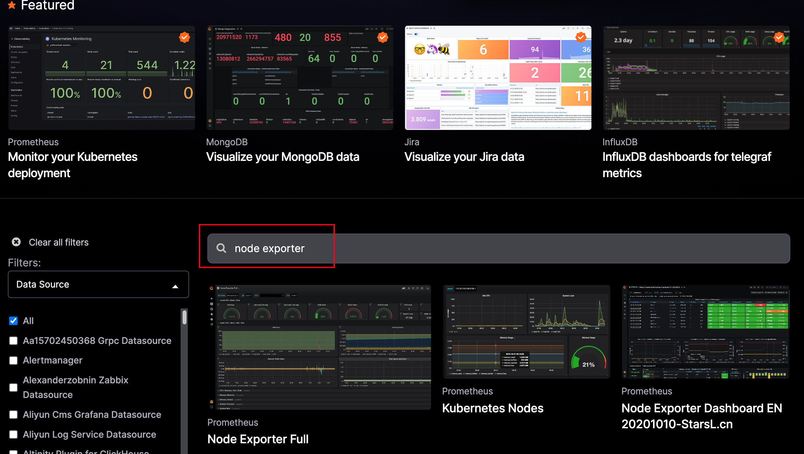

- **学习资料**：
  - Promethues
      - 官方文档： https://prometheus.io/docs/prometheus/latest/getting_started/
      - 源码库： https://github.com/prometheus/prometheus
      - 核心概念：https://prometheus.io/docs/concepts/data_model/
      - Exporters 列表：https://prometheus.io/docs/instrumenting/exporters/
      - Alertmanager 配置：https://prometheus.io/docs/alerting/latest/alertmanager/
      - PromQL 教程：https://prometheus.io/docs/prometheus/latest/querying/basics/
  - Grafana
      - Grafana 官方文档：https://grafana.com/docs/grafana/latest/
      - 源码库：https://github.com/grafana/grafana
      - Prometheus 数据源配置：https://grafana.com/docs/grafana/latest/datasources/prometheus/
      - 仪表盘管理：https://grafana.com/docs/grafana/latest/dashboards/
      - 告警配置：https://grafana.com/docs/grafana/latest/alerting/

- **总结**

Prometheus 作为一个功能强大的开源监控系统，以其高效的时间序列数据存储、灵活的 PromQL 查询语言和对云原生环境的天然支持，成为现代分布式系统监控的首选工具。它通过多维数据模型、自动服务发现和强大的告警机制，帮助用户实时洞察系统性能，快速定位和解决问题。无论是监控微服务、Kubernetes 集群还是传统应用，Prometheus 都能提供可靠的解决方案。结合其轻量级 Web UI 和与 Grafana、Alertmanager 等工具的良好集成，Prometheus 为开发者和运维人员提供了一个简单却强大的监控生态，助力构建高可用、高性能的系统。