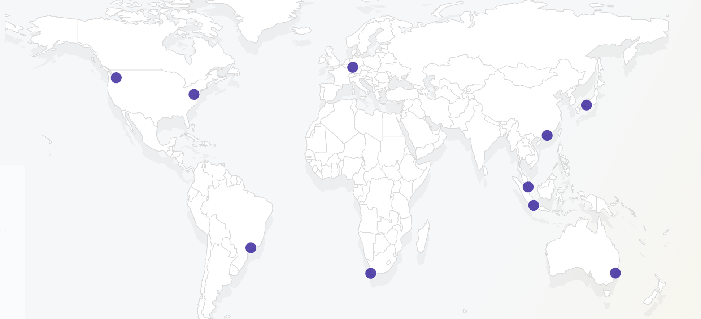
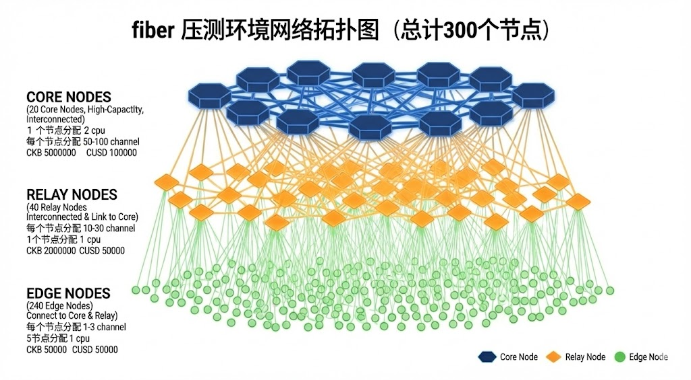
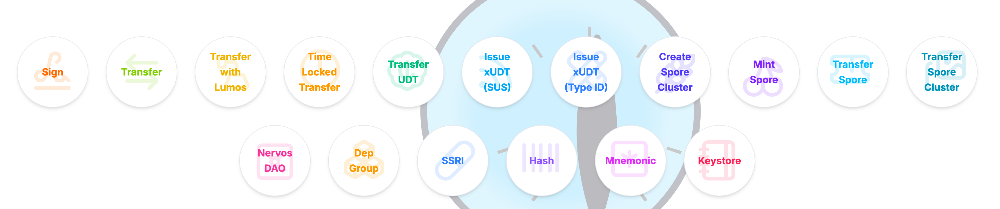
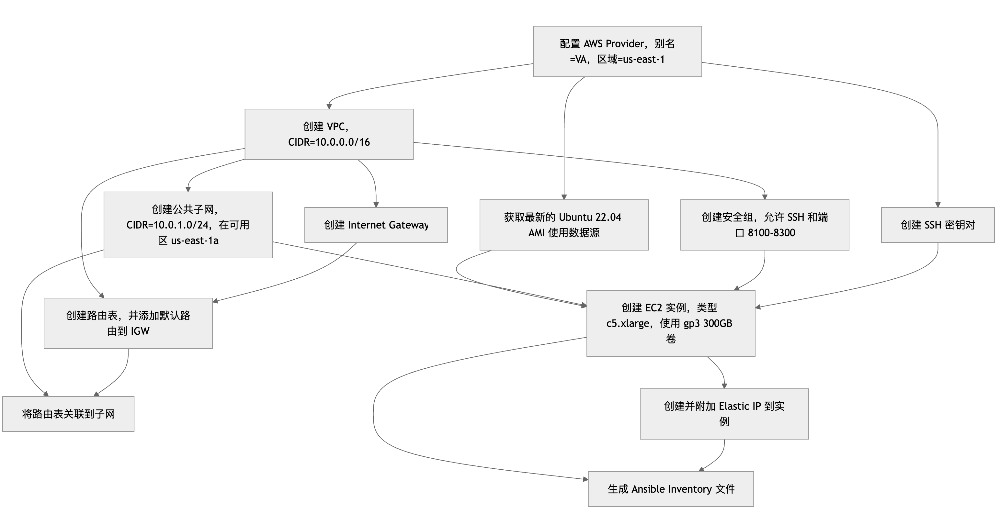
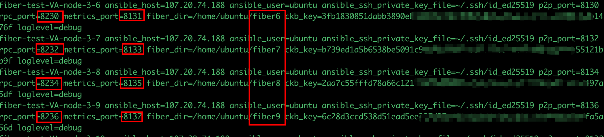
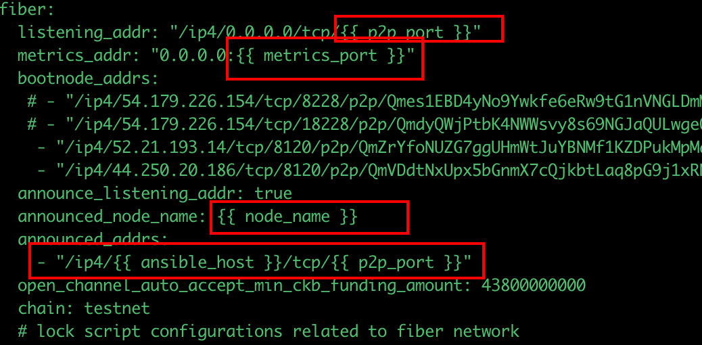
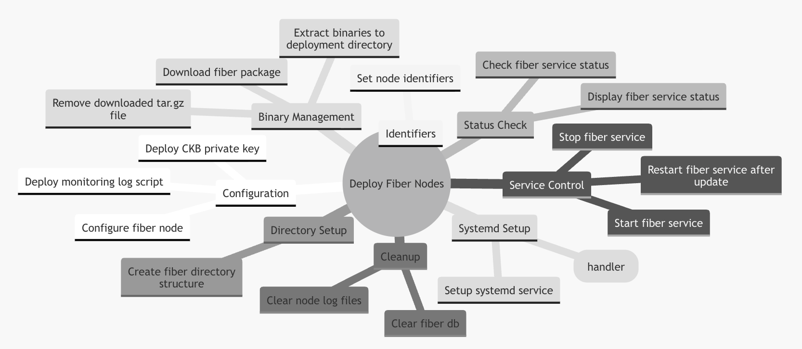
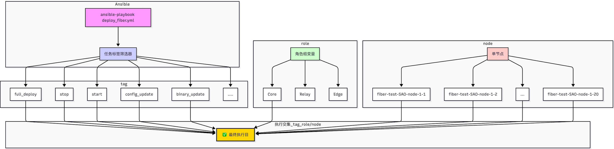
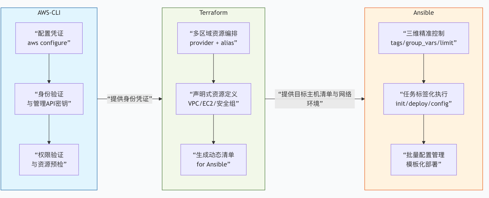

# fiber 大规模节点压测自动化部署
> 介绍如何利用Terraform和Ansible两大DevOps工具，在云环境中快速部署300个Fiber节点的压测环境。涵盖从基础设施编排到应用部署的全流程自动化方案。

- **前期规划/准备**：
  - 环境需求分析
    - 节点数量 (300)
    - 即开即用
    - 成本控制
    - 节点分布
  
    
    
    - 节点网络拓扑与Token分配
  
    

    - 网络架构设计
      - VPC/子网划分 (弹性IP)
      - 安全组规则（节点P2P端口、RPC端口、metrics端口）
    - ckb 钱包与代币
      - 生成 300个 ckb 钱包
      - 申请 testnet ckb
      - 自定义创建 UDT
      - 代币分发
  
  - 技术栈确认
    - 云服务商选择 (AWS)
    - Terraform 版本 (≥v1.12）
    - Ansible 版本 (≥2.17)
    - Fiber 二进制版本 (0.7.1)
  
- **工具介绍**：
  - aws-cli
      - AWS 官方提供的命令行工具，核心任务是为 身份认证 和 区域/服务配置 提供统一的标准
      - 认证与凭证管理
          - IAM 角色(access_key、secret_key)
      - 区域和默认配置
  - Terraform
      - 作用：跨云平台（AWS/Azure/GCP等）的统一基础设施编排
      - 核心功能：
          - 声明式配置管理，版本控制基础设施
          - 自动化资源创建（虚拟机、网络、安全组等）
          - 支持多云和混合云环境
          - 状态管理，确保基础设施一致性
  - Ansible
    - 作用：自动化运维工具，通过 SSH 协议实现对大规模服务器集群的统一配置、管理和应用发布。
    - 核心功能：
        - 无代理（Agentless）：不需要在目标主机安装代理软件，只需 SSH 或 WinRM 连接。
        - 简单易用：使用 YAML 格式编写 Playbooks，描述自动化任务，易于阅读和维护。
        - 幂等性：多次运行同一任务，结果一致，避免重复操作。
        - 模块化：内置大量模块（如 file、command、yum），支持自定义扩展。
  - [CCC App](https://app.ckbccc.com/)
    - CKB 社区开发的 JavaScript/TypeScript 一站式工具箱
    - 批量创建钱包，转账
    - 自定义XUDT（100亿，cusd）
  
    

- **实战**：
  - Terraform 基础设施代码 (main.tf)
    - terraform init
    - terraform apply
    - 生成 Ansible 需要的主机列表
  
    ``` 
    fiber-test-VA-node-1 ansible_host=52.21.193.14 ansible_user=ubuntu ansible_ssh_private_key_file=~/.ssh/id_ed25519 
    ```

    - 服务器资源创建逻辑

    ```
    # 配置 AWS Providers 使用别名
    provider "aws" {
    alias  = "VA"
    region = "us-east-1"
    } 
    # 获取最新的 Ubuntu 22.04 AMI
    data "aws_ami" "ubuntu_VA" {
    provider    = aws.VA
    most_recent = true
    owners      = ["099720109477"] # Canonical

    filter {
        name   = "name"
        values = ["ubuntu/images/hvm-ssd/ubuntu-jammy-22.04-amd64-server-*"]
    }
    }
    # 创建 SSH 密钥对
    resource "aws_key_pair" "fiber_test_key_VA" {
    provider   = aws.VA
    key_name   = "fiber-test-key-VA"
    public_key = file("~/.ssh/id_ed25519.pub")
    }
    # 创建 VPC
    resource "aws_vpc" "main_VA" {
    provider             = aws.VA
    cidr_block           = "10.0.0.0/16"
    enable_dns_hostnames = true
    enable_dns_support   = true

    tags = {
        Name = "fiber-test-vpc-VA"
    }
    }
    # 创建子网
    resource "aws_subnet" "public_VA" {
    provider                = aws.VA
    vpc_id                  = aws_vpc.main_VA.id
    cidr_block              = "10.0.1.0/24"
    map_public_ip_on_launch = true
    availability_zone       = "us-east-1a"

    tags = {
        Name = "fiber-test-subnet-VA"
    }
    }
    # 创建 Internet Gateway
    resource "aws_internet_gateway" "gw_VA" {
    provider = aws.VA
    vpc_id   = aws_vpc.main_VA.id

    tags = {
        Name = "fiber-test-igw-VA"
    }
    }
    # 创建路由表
    resource "aws_route_table" "public_VA" {
    provider = aws.VA
    vpc_id   = aws_vpc.main_VA.id

    route {
        cidr_block = "0.0.0.0/0"
        gateway_id = aws_internet_gateway.gw_VA.id
    }

    tags = {
        Name = "fiber-test-route-table-VA"
    }
    }
    # 将路由表关联到子网
    resource "aws_route_table_association" "public_VA" {
    provider       = aws.VA
    subnet_id      = aws_subnet.public_VA.id
    route_table_id = aws_route_table.public_VA.id
    }
    # 创建安全组
    resource "aws_security_group" "fiber_test_sg_VA" {
    provider    = aws.VA
    name        = "fiber-test-security-group-VA"
    description = "Security group for fiber test instances in VA"
    vpc_id      = aws_vpc.main_VA.id

    ingress {
        description = "SSH"
        from_port   = 22
        to_port     = 22
        protocol    = "tcp"
        cidr_blocks = ["0.0.0.0/0"]
    }

    ingress {
        description = "TCP ports 8100-8300"
        from_port   = 8100
        to_port     = 8300
        protocol    = "tcp"
        cidr_blocks = ["0.0.0.0/0"]
    }

    egress {
        from_port   = 0
        to_port     = 0
        protocol    = "-1"
        cidr_blocks = ["0.0.0.0/0"]
    }

    tags = {
        Name = "fiber-test-sg-VA"
    }
    }
    # 创建 EC2 实例
    resource "aws_instance" "fiber_test_nodes_VA" {
    provider          = aws.VA
    count             = 4
    ami               = data.aws_ami.ubuntu_VA.id
    instance_type     = "c5.xlarge"
    subnet_id         = aws_subnet.public_VA.id
    security_groups   = [aws_security_group.fiber_test_sg_VA.id]
    key_name          = aws_key_pair.fiber_test_key_VA.key_name

    root_block_device {
        volume_type = "gp3"
        volume_size = 300
    }

    tags = {
        Name = "fiber-test-VA-node-${count.index + 1}"
    }
    }
    # 创建并绑定 Elastic IP
    resource "aws_eip" "node_eip_VA" {
    provider = aws.VA
    count    = 4
    instance = aws_instance.fiber_test_nodes_VA[count.index].id

    tags = {
        Name = "fiber-test-eip-VA-${count.index + 1}"
    }
    }
    # 生成 Ansible inventory 文件
    resource "local_file" "ansible_inventory" {
    filename = "${path.module}/inventory.ini"
    content  = <<EOT
    [Core]
    ${aws_instance.fiber_test_nodes_VA[0].tags.Name} ansible_host=${aws_eip.node_eip_VA[0].public_ip} ansible_user=ubuntu ansible_ssh_private_key_file=~/.ssh/id_ed25519
    ```
    

  - Ansible Playbook 结构
  
    ```
    fiber-ansible/
    ├── ansible.cfg
    ├── deploy_fiber.yml
    ├── deploy_monitor_logs.yml
    ├── group_vars
    │   └── all.yml
    ├── inventory
    │   ├── hosts.ini
    └── templates
        ├── config.yml.j2
        ├── fiber.service.j2
        ├── monitor_logs.sh.j2
    ```
  - ansible.cfg 核心配置文件
    - 设置Ansible的默认行为，指定SSH私钥路径，Python，目标节点主机列表等
  - inventory/hosts.ini - 主机清单文件
    - 格式：fiber节点名称、节点IP、用户名、本地私钥、端口（p2p、rpc、metrics)、部署目录、ckb 钱包私钥，日志级别
  
    
    
  - group_vars/all.yml - 全局变量定义
    - discord_webhook_url
    - secret_key_password
  - templates/ - Jinja2模板目录
    - config.yml.j2   
      - fiber 节点的配置文件
   
    
   
    - fiber.service.j2  
      - fiber 节点 systemd 管理文件
    - monitor_logs.sh.j2  
      - fiber 节点日志监控
  
  - deploy_fiber.yml - 主部署文件
    - 核心部署逻辑，初始化，下载安装、更新配置、管理 fiber 进程。

    
   
  - 标签驱动执行
    - full_deploy
    - config_update
    - binary_update
    - clear_db
    - start/stop/restart
  - 执行命令示例
    - ansible-playbook deploy_fiber.yml --tags full_deploy
    - ansible-playbook deploy_fiber.yml --tags binary_update -e "target_groups=Core”
    - ansible-playbook deploy_fiber.yml --tags stop -l "fiber-test-SAO-node-1-2”

    
  
- **总结：**
  - 通过 **AWS-CLI、Terraform 和 Ansible** 三工具协作，构建了一个完整的基础设施与应用部署自动化流水线。

    